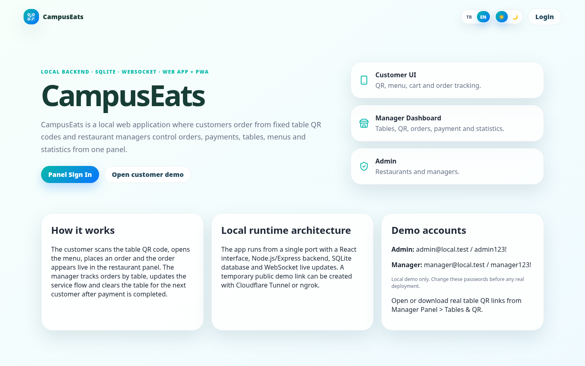
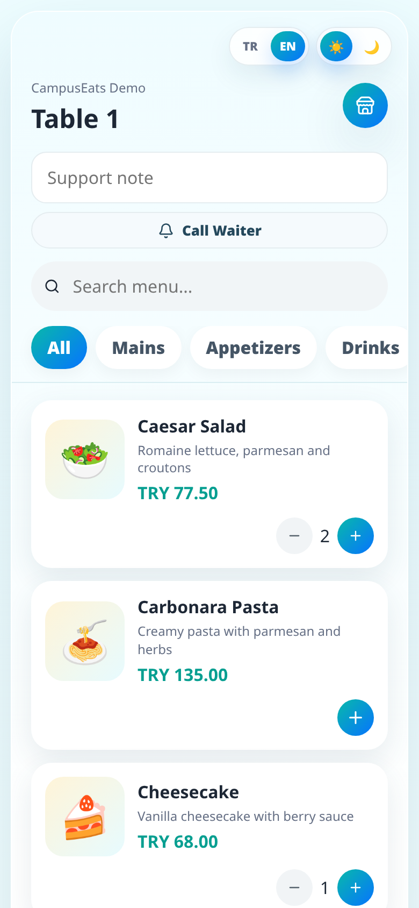
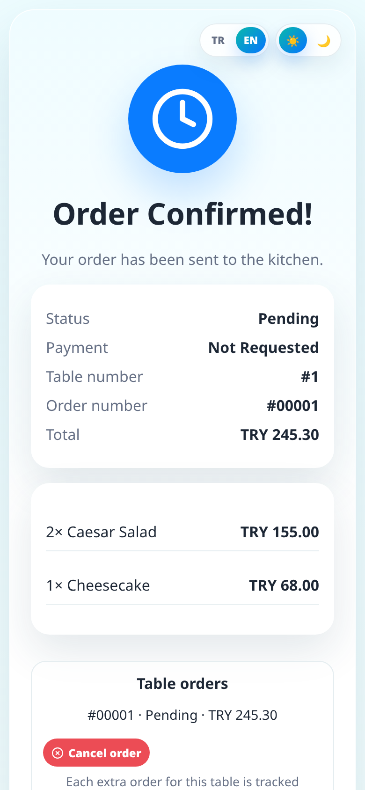
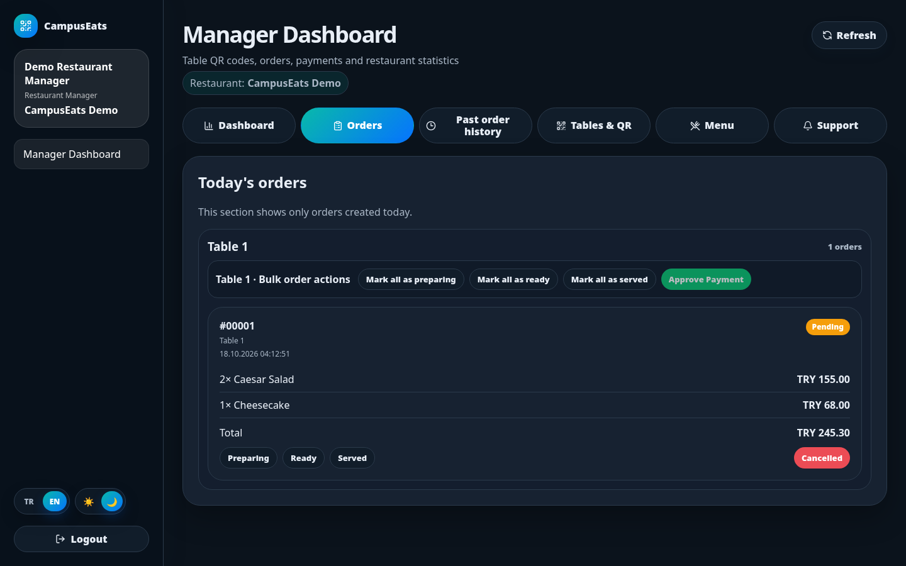
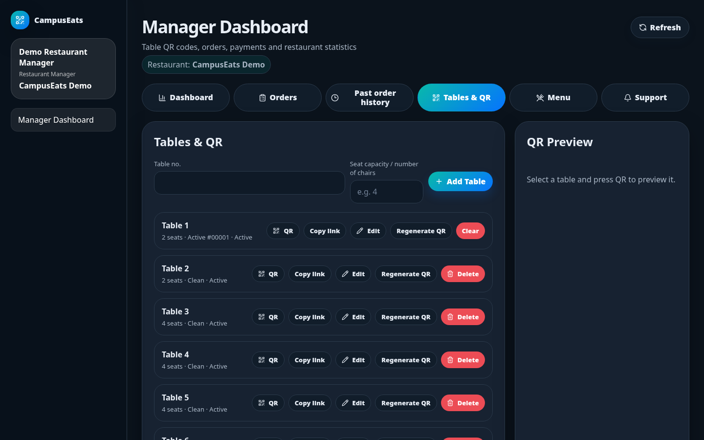
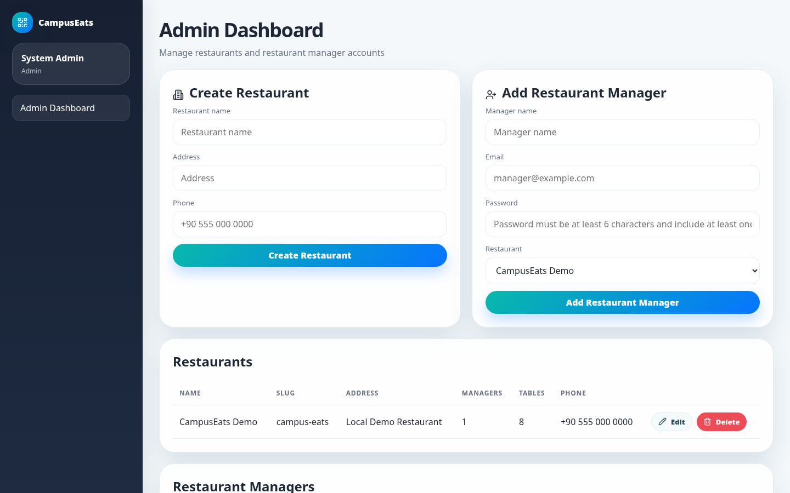
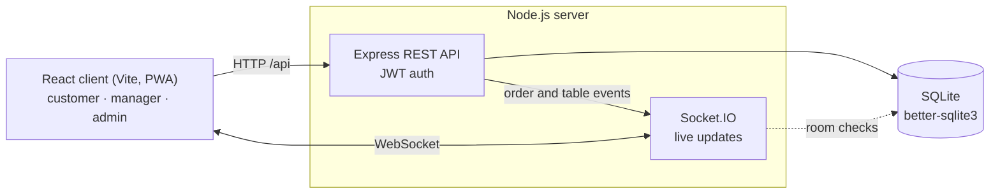

# CampusEats

A smart QR-based restaurant ordering system that runs entirely on your machine. Customers scan a fixed table QR code, browse the menu and order from their phone; restaurant managers handle orders, payments, tables and the menu live from one panel.

> 🎓 **Eastern Mediterranean University · Graduation Project (2026)**

**Stack:** React 19 + Vite · Node.js / Express · SQLite (`better-sqlite3`) · Socket.IO · PWA



## Project Context & My Contributions

Campus cafeterias get crowded at peak hours: customers wait for a menu, wait to order and wait for the bill, while staff track orders on paper. CampusEats lets a customer order and follow the order from their own phone by scanning the QR code on the table, and gives restaurant staff one live panel for orders, tables, the menu and payments.

CampusEats is my individual graduation project at Eastern Mediterranean University.

## Screenshots

| Customer menu | Order status |
|---|---|
|  |  |

**Manager panel: live orders grouped by table (dark theme)**



**Manager panel: tables and fixed QR codes**



**Admin panel: restaurants and manager accounts**



## Features

**Customer (mobile web / PWA)**
- Opens the menu from a fixed table QR link (`/r/<restaurant-slug>/table/<token>`)
- Search, category filter, cart with per-item notes, 10% tax included in the total
- Live order tracking; the status screen title changes with each stage
- Several separate orders per table (“Add more items” opens a new order card)
- Cancel an order while it is still **Pending**
- Call a waiter, or ask for help from the invalid QR page
- Choose card, IBAN transfer or cash at checkout ([simulated](#payment-simulation), no real money is charged)

**Restaurant manager**
- Dashboard: today’s numbers, 7- and 30-day revenue, order counts, average ticket, best sellers, recently cancelled orders
- Today’s orders grouped by table, with bulk actions per table (preparing → ready → served → approve payment)
- Order history grouped by day; clearing closed orders asks for confirmation twice
- Table CRUD, QR preview/download, regenerate a QR, clear a table session
- Menu and category CRUD; category names and sort numbers must be unique per restaurant
- Menu image upload, resized to fit 900×900 and saved as WebP (quality 88)
- Live updates for orders and support requests via Socket.IO

**System admin**
- Create, edit and delete restaurants (deleting a restaurant also deletes its managers)
- Create and edit manager accounts (email, password, assigned restaurant)
- Field-level validation errors on both frontend and backend, in the UI language

**General**
- Turkish / English UI and light / dark theme, saved in `localStorage`
- Installable PWA with app icons
- Payment approval clears the table session; the same QR code then works for the next customer

## Architecture



- **REST API** handles every change: login, orders, status updates, payments, menu and table management. Manager and admin routes require a JWT; the user’s role and restaurant are read from the database on each request.
- **Socket.IO** only pushes updates. A manager connects with their JWT and can join only their own restaurant’s room. A customer joins the room of their own order, using the order’s random ID as the access key, and receives only the fields the order screen needs.
- **SQLite** holds all data in a single local file. Demo data is seeded on first start.

## Getting started

Requires Node.js 20+.

```bash
npm run install:all
npm run dev
```

- Frontend: http://localhost:5173
- Backend API: http://localhost:4000

To run it like production (Express serves the React build on a single port, http://localhost:4000):

```bash
npm run build
npm start
```

Optional: copy `server/.env.example` to `server/.env` to set the port, origins and JWT secret. To reset the database back to the demo data, run `npm --prefix server run reset-db`.

### JWT secret

- **Local demo:** no setup needed. If `JWT_SECRET` is empty, a random secret is generated once and kept in `server/data/jwt-secret` (git-ignored).
- **Production or public URL:** when `NODE_ENV=production`, or `PUBLIC_APP_URL` is anything other than `localhost` or a private LAN address (for example a Cloudflare Tunnel or ngrok URL), the server **refuses to start** unless `JWT_SECRET` is a random value of at least 32 characters:

  ```bash
  node -e "console.log(require('crypto').randomBytes(32).toString('hex'))"
  ```

## Demo Environment

On first start the server seeds a demo restaurant (**CampusEats Demo**) with a menu, 8 tables and the two accounts below. These accounts exist **for testing and evaluation**, so that the project can be reviewed without any setup. They are not meant for real use.

> ⚠️ **Local demo only.** Change the passwords before exposing the app anywhere, including a temporary tunnel, and set a [JWT secret](#jwt-secret).

| Role | Email | Password |
|---|---|---|
| System Admin | `admin@local.test` | `admin123!` *(local demo only)* |
| Restaurant Manager | `manager@local.test` | `manager123!` *(local demo only)* |

Password policy: at least 6 characters, including at least one number and one special character.

## Demo walkthrough

1. Sign in as `manager@local.test` and open **Tables & QR**.
2. Copy a table link or download its QR code (or click **Open customer demo** on the landing page).
3. As the customer, add items to the cart and confirm the order. It appears live under **Orders**.
4. Place more orders from the same table; each one gets its own card.
5. Move the table’s orders through **Preparing → Ready → Served**.
6. Once every active order is served, the customer requests payment. Card or IBAN payments are approved automatically; for cash, the manager clicks **Approve Payment**.
7. The table session is cleared and the same QR code is ready for the next customer.

## Payment Simulation

CampusEats has **no payment provider integration**. No card data is collected and no money moves.

- **Card** and **IBAN transfer** are approved automatically as soon as the customer picks them, to stand in for a successful online payment.
- **Cash** waits until a manager confirms it with **Approve Payment**.

The customer’s payment screen shows the same notice. A real deployment would need a payment provider in place of the automatic approval.

## Testing

```bash
npm test
```

The tests use Node’s built-in test runner against an in-memory SQLite database, so they never touch your demo data. GitHub Actions runs them on Node 20, 22 and 24 for every push and pull request, and also builds the frontend.

What CI checks:

- **JWT secret policy:** the server refuses a missing, short or previously published secret in production or behind a public URL.
- **REST authorization:** requests with missing, forged or expired tokens, or tokens for deleted users, are rejected (401). Roles are enforced (403), and a manager cannot change another restaurant’s tables.
- **Socket.IO rooms:** bad tokens are rejected at the handshake. Anonymous users and admins cannot join restaurant rooms, and manager A cannot join manager B’s room. A customer receives only their own order’s updates, without internal fields.
- **Order flow:** Pending → Preparing → Ready → Served → payment request, with each step pushed live to the customer.
- **Payments:** card and IBAN are approved automatically. Cash waits for the manager and cannot be skipped by changing the order status.
- **Frontend build:** `npm run build` succeeds for the React client.

Not covered: there are no frontend unit or UI tests, and menu/image upload, admin form validation, QR generation, the dashboard statistics and order cancellation have no automated tests yet.

## Project structure

```text
client/             React + Vite frontend (customer UI, manager and admin panels, PWA)
server/             Express API, Socket.IO, SQLite database, image uploads
server/test/        API, Socket.IO and order flow tests (node:test, in-memory SQLite)
.github/workflows/  CI: server tests and frontend build
docs/               README screenshots
```

## Notes

- The SQLite database is created at `server/data/campuseats.sqlite` (git-ignored).
- Uploaded menu images are stored in `server/public/uploads/menu/` (git-ignored).
- QR codes are fixed per table. Approving a payment resets the table’s active session, not its QR code.

## License

[MIT](LICENSE)
